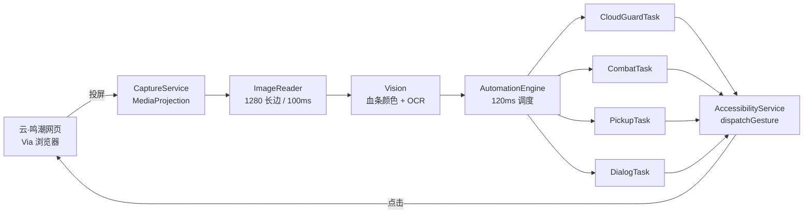

# OKWW Mobile · 云·鸣潮手机端自动化

把 PC 端 [ok-oldking/ok-wuthering-waves](https://github.com/ok-oldking/ok-wuthering-waves)（下称 OKWW）的自动化思路迁移到 Android：面向 **「云·鸣潮」网页版**（`https://mc.kurogames.com/cloud/`）+ **Via 浏览器**的横屏 / 全屏 / 游戏模式，用投屏像素分析 + 离线 OCR + 无障碍手势实现自动战斗、自动拾取、跳过剧情和云断线自动重连。

- 纯 Kotlin，**无需 root、无需 Xposed**
- 不修改游戏客户端，只读取屏幕、模拟点击
- 单 APK（约 48MB，内含离线中文 OCR 模型）

> ⚠️ 本项目尚未在真机 / 模拟器上完整验证，默认按键坐标只是起点，**使用前必须先校准**。详见 [已知限制](#已知限制)。

---

## 目录

- [功能特性](#功能特性)
- [与 OKWW 的关系](#与-okww-的关系)
- [工作原理](#工作原理)
- [环境要求](#环境要求)
- [构建](#构建)
- [安装与授权](#安装与授权)
- [快速开始](#快速开始)
- [按键校准](#按键校准)
- [任务与默认节奏](#任务与默认节奏)
- [项目结构](#项目结构)
- [常见问题](#常见问题)
- [已知限制](#已知限制)
- [免责声明](#免责声明)
- [License](#license)

---

## 功能特性

| 功能 | 说明 |
| --- | --- |
| **云断线守护** | OCR 识别「云服务错误 / 1020 / 连接中断」弹窗，自动点击重试；识别「排队中」时安静等待；识别「进入游戏 / 复苏」时自动进场 |
| **自动战斗** | 通过血条颜色检测（普通怪红条 / Boss 红条）判断是否进入战斗，按节奏释放普攻、技能、解放、声骸，可自动切人、可选锁定目标 |
| **自动拾取** | OCR 识别「吸收 / 拾取 / 采集 / 调查」等提示并点击，黑名单排除「开始合成 / 领取奖励 / 确认」等误判 |
| **自动跳过剧情** | 识别对白区文字密度，优先点「跳过」，否则点对话推进点 |
| **血条宽限** | 参考 OKWW 的 `CLOUD_HEALTH_LOST_GRACE = 3s`：串流画面血条闪烁时不会误判脱战 |
| **串流去重** | 云端延迟下同一动作 2.2s 内不重复执行，避免连点风暴 |
| **Via 游戏模式** | 一键锁横屏、调最大亮度、开启免打扰；授权后可全局沉浸全屏（隐藏状态栏 / 导航栏） |
| **按键校准** | 14 个触控点位可视化拖拽，归一化坐标（0~1）适配任意分辨率与网页缩放 |
| **悬浮控制台** | 游戏内悬浮面板，随时开始 / 停止 / 查看状态与日志 |
| **安全暂停** | 本应用界面（控制台 / 校准页）在前台时自动暂停点击，避免误触自身 UI |

---

## 与 OKWW 的关系

| | OKWW（PC） | OKWW Mobile（本项目） |
| --- | --- | --- |
| 平台 | Windows | Android 8.0+ |
| 技术栈 | Python + PySide6 | Kotlin + AndroidX + Material |
| 画面获取 | Windows 窗口截图 | MediaProjection 投屏采集 |
| 识别方式 | OpenCV 模板匹配（约 2GB 图集） | 血条颜色检测 + ML Kit 离线中文 OCR |
| 输入注入 | win32 `SendInput` | 无障碍 `dispatchGesture` |
| 目标场景 | PC 客户端 | 云·鸣潮网页版（Via 浏览器） |
| 适配方式 | 固定分辨率模板 | 归一化坐标 + 可校准点位 |

选择重写而非移植的原因：云游戏画面经过视频编码，模板匹配对画质 / 缩放极其敏感，且模板图集体积过大；改用颜色 + OCR 后在串流画质下更稳定，APK 体积也控制在 50MB 内。

---

## 工作原理



核心模块：

| 模块 | 文件 | 职责 |
| --- | --- | --- |
| 采集 | [CaptureService.kt](app/src/main/java/com/okww/mobile/service/CaptureService.kt) | MediaProjection + VirtualDisplay + ImageReader，长边压缩到 1280，旋转自动重建 |
| 手势 | [AutoAccessibilityService.kt](app/src/main/java/com/okww/mobile/service/AutoAccessibilityService.kt) | 无障碍手势注入：点击 / 长按 / 滑动 / 返回 |
| 视觉 | [Vision.kt](app/src/main/java/com/okww/mobile/engine/Vision.kt) | 暗屏检测、Boss / 普通血条颜色检测、ML Kit 中文 OCR（700ms 节流） |
| 任务 | [Tasks.kt](app/src/main/java/com/okww/mobile/engine/tasks/Tasks.kt) | 云断线守护、自动战斗、自动拾取、跳过剧情 |
| 调度 | [Engine.kt](app/src/main/java/com/okww/mobile/engine/Engine.kt) | 主循环、任务优先级、战斗内降低 OCR 频率 |
| 配置 | [AutoConfig.kt](app/src/main/java/com/okww/mobile/config/AutoConfig.kt) | 归一化点位、开关、节奏参数，SharedPreferences + JSON 持久化 |
| 游戏模式 | [ViaHelper.kt](app/src/main/java/com/okww/mobile/ui/ViaHelper.kt) | Via 拉起、横屏锁定、亮度、免打扰、沉浸全屏 |
| 校准 | [CalibrationActivity.kt](app/src/main/java/com/okww/mobile/ui/CalibrationActivity.kt) | 基于当前投屏画面拖拽点位并保存 |
| 悬浮窗 | [OverlayService.kt](app/src/main/java/com/okww/mobile/service/OverlayService.kt) | 游戏内控制台 + WakeLock 保持亮屏 |

判定要点：

- 普通怪血条：区域 x `0.16~0.84` / y `0.14~0.86`，红色像素比例超过阈值即进入战斗（BGR 约 r174-225 / g55-85 / b55-76）。
- Boss 血条：区域 x `0.32~0.68` / y `0.018~0.105`，红色比例超过 `0.6%`。
- 画面整体亮度低于 28 且占比 > 88% 判为「加载中」，暂停点击。
- 云断线 / 排队 / 登录验证优先于战斗逻辑；遇到密码或验证码会停止并提示人工处理。

---

## 环境要求

- 手机：Android 8.0（API 26）及以上，建议 8GB 内存、横屏使用
- 构建：JDK 17、Android SDK Platform 35、Gradle 8.14.6（仓库已带 wrapper）
- 依赖：AGP 8.7.3、Kotlin 2.0.21、ML Kit `text-recognition-chinese:16.0.1`

---

## 构建

```bash
git clone https://github.com/jiang386/okww-mobile.git
cd okww-mobile

# 使用仓库自带 wrapper（推荐）
./gradlew :app:assembleDebug

# 或使用本机 Gradle
gradle :app:assembleDebug
```

产物：`app/build/outputs/apk/debug/app-debug.apk`

已打包好的版本可直接下载：
[okww-mobile-0.1.0-debug.apk](https://github.com/jiang386/okww-mobile/raw/main/okww-mobile-0.1.0-debug.apk)

构建提示：

- 首次构建需联网下载 AGP / AndroidX / ML Kit 依赖，体积较大请耐心等待。
- 若处于代理环境，可在 `gradle.properties` 或命令行传入 `-Dhttp.proxyHost=... -Dhttps.proxyHost=...`，并确保 `nonProxyHosts` 包含 `localhost|127.0.0.1`。
- 如果 SDK 路径不同，请修改根目录 `local.properties` 的 `sdk.dir`（该文件不入库）。

---

## 安装与授权

安装后需要开启以下权限，缺一不可：

1. **屏幕投屏**（MediaProjection）——用于读取云游戏画面。Android 14+ 每次启动应用都需重新授权。
2. **无障碍服务**（OKWW 自动操作）——用于模拟点击。设置 → 无障碍 → 已下载的服务 → OKWW。
3. **悬浮窗**（显示在其他应用上层）——用于悬浮控制台与游戏内状态。
4. **通知**（Android 13+）——前台采集服务需要常驻通知。
5. **关闭电池优化**——防止后台被系统冻结导致自动化中断。

可选：全局沉浸全屏、隐藏状态栏需要一次性 adb 授权：

```bash
adb shell pm grant com.okww.mobile android.permission.WRITE_SECURE_SETTINGS
```

也可以在应用内「说明 / 游戏模式」弹窗里直接复制该命令。

---

## 快速开始

1. 打开 OKWW，依次完成上述五项授权，主界面权限状态会显示 ✓。
2. 点 **「打开云·鸣潮」**，用 Via 打开 `https://mc.kurogames.com/cloud/`。
3. 在 Via 菜单中切换到**桌面版网页 / 全屏**，保持横屏。
4. 回到 OKWW 点 **「游戏模式」**：锁定横屏、调到最大亮度、开启免打扰（按需）。
5. **进入云游戏画面后先做一次 [按键校准](#按键校准)**，否则默认坐标可能点空。
6. 勾选需要的任务（云断线守护 / 自动战斗 / 自动拾取 / 自动跳过剧情 / 自动切人），点 **「开始」**。
7. 可开启 **「悬浮控制台」** 在游戏内随时启停；要停止自动化时点主界面「停止」或悬浮窗「停止」。

> 首次进入云游戏大厅时，登录、实名、验证码等必须手动完成；自动化只在进入游戏画面后生效。

---

## 按键校准

不同机型、不同网页缩放会让按钮位置差异很大，**校准是必需步骤**：

1. 进入云游戏实际战斗画面（保证后台有真实截图）。
2. 主界面点 **「校准」**，页面会加载当前投屏画面作为底图。
3. 拖动 14 个圆点到对应按钮中心，可点「测试点击」确认落点。
4. 点「保存」写入本地配置；「恢复默认」可回到内置坐标。

14 个点位：

| 键 | 含义 | 默认坐标 (x, y) |
| --- | --- | --- |
| ATTACK | 普攻 | 0.880, 0.740 |
| SKILL | 共鸣技能 | 0.752, 0.600 |
| ULTIMATE | 共鸣解放 | 0.905, 0.470 |
| ECHO | 声骸技能 | 0.672, 0.730 |
| DODGE | 闪避 | 0.725, 0.865 |
| JUMP | 跳跃 | 0.625, 0.900 |
| INTERACT | 交互 / 拾取 F | 0.855, 0.430 |
| SWITCH_1/2/3 | 切人 1/2/3 | 0.955, 0.780 / 0.855 / 0.930 |
| JOYSTICK | 摇杆中心 | 0.130, 0.670 |
| DIALOG_ADVANCE | 对话推进 | 0.800, 0.780 |
| TARGET | 锁定目标 | 0.930, 0.300 |
| FULLSCREEN | 全屏按钮 | 0.965, 0.060 |

坐标均为相对屏幕的归一化值，与分辨率无关。

配置存放在应用私有 SharedPreferences（`okww_config`）中，JSON 格式，包含点位、任务开关与节奏参数。

---

## 任务与默认节奏

| 参数 | 默认值 | 说明 |
| --- | --- | --- |
| 普攻间隔 | 320ms | 自动战斗中的连击节奏 |
| 技能间隔 | 1600ms | 共鸣技能 |
| 解放间隔 | 6000ms | 共鸣解放 |
| 声骸间隔 | 9000ms | 声骸技能 |
| 切人间隔 | 15000ms | 自动切人周期 |
| 锁定间隔 | 3000ms | 自动锁定目标（默认关闭） |
| 血条宽限 | 3000ms | 血条消失后仍视为战斗中的时间 |
| 云守护间隔 | 900ms（战斗内 2200ms） | OCR 巡检弹窗的频率 |

任务优先级（每 tick 120ms）：云断线守护 → 暗屏等待 → 跳过剧情 → 自动拾取（非战斗）→ 自动战斗。

---

## 项目结构

```
okww-mobile/
├── app/
│   ├── build.gradle.kts              # 应用配置与依赖
│   ├── proguard-rules.pro            # 混淆保留规则
│   └── src/main/
│       ├── AndroidManifest.xml       # 权限、服务、Activity 声明
│       ├── java/com/okww/mobile/
│       │   ├── App.kt                # 全局配置、通知渠道、前后台计数
│       │   ├── config/AutoConfig.kt  # 点位、开关、节奏、持久化
│       │   ├── engine/               # Vision / Engine / tasks
│       │   ├── service/              # 采集、无障碍、悬浮窗
│       │   ├── ui/                   # 主界面、校准、Via/游戏模式
│       │   └── util/                 # 日志总线、屏幕信息
│       └── res/                      # 布局、样式、图标
├── gradle/wrapper/                   # Gradle Wrapper
├── build.gradle.kts
├── settings.gradle.kts
└── gradle.properties
```

---

## 常见问题

**Q：点了「开始」但技能没反应？**
先做按键校准；再确认无障碍服务已开启、投屏授权未过期（Android 14+ 每次启动都要重新授权）。

**Q：一直提示「画面加载中」？**
云游戏画质过低或画面全黑时会触发暗屏保护，等待加载完成即可；若一直黑屏，检查投屏是否被系统回收。

**Q：自动拾取不生效？**
OCR 依赖文字可见。若云画面分辨率太低，可在 Via 中调高画质；也确认拾取提示确实出现在屏幕下中部区域。

**Q：提示「需要人工登录 / 验证」？**
云游戏出现密码框、验证码或实名弹窗时，自动化会主动停止，手动完成后重新点开始。

**Q：全屏 / 隐藏状态栏无效？**
沉浸全屏需要 `WRITE_SECURE_SETTINGS`（见 [安装与授权](#安装与授权)），普通 `WRITE_SETTINGS` 只能改亮度与旋转。

**Q：玩一会儿自动化自己停了？**
多半是电池优化冻结了后台，请把 OKWW 加入电池白名单；部分机型还需在最近任务里锁定应用。

**Q：悬浮窗看不到？**
确认「显示在其他应用上层」权限已开；部分系统（MIUI / HyperOS / ColorOS）需要单独允许后台弹出界面。

**Q：开启无障碍时提示「系统已拒绝向此应用授予访问权限」？**
这是 Android 13+ 对侧载（非应用商店安装）应用的「受限设置」保护，不是安装包损坏。处理：设置 → 应用 → 应用管理 → OKWW → 右上角 **⋮ → 允许受限设置**（可能需验证锁屏密码），再回到 设置 → 无障碍 → 已下载的应用 → OKWW 开启。若没有该菜单项，可用 adb 放开：

```bash
adb shell appops set com.okww.mobile ACCESS_RESTRICTED_SETTINGS allow
```

---

## 已知限制

- **未在真机 / 模拟器上完整验证**，仅有编译与 APK 结构校验通过。
- **默认按键坐标必须校准**，云·鸣潮网页布局更新后也需要重新校准。
- 血条颜色阈值按 1280 长边的画面设计，极少数机型 / 极低画质下可能需要微调。
- 自动化强依赖投屏授权与无障碍服务，任一被系统回收就会停止。
- 云游戏本身的排队、登录、验证码、封号风险不由本项目控制。
- 云端串流延迟较高时，点击与画面反馈存在天然滞后，节奏参数可适当调大。

---

## 免责声明

本项目仅供学习与技术研究，不修改游戏客户端、不注入进程、不破解协议。使用自动化可能违反游戏或云游戏平台的用户协议，由此产生的一切后果（包括账号处罚）由使用者自行承担。请遵守相关服务条款，理性使用。

参考项目：[ok-oldking/ok-wuthering-waves](https://github.com/ok-oldking/ok-wuthering-waves)（MIT）。

---

## License

[MIT](LICENSE) © 2026 jiang386
