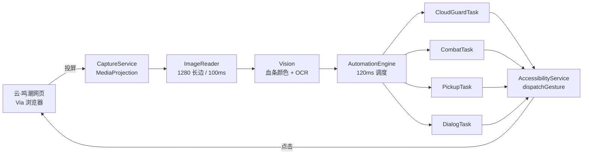

# OKWW Mobile · 云·鸣潮手机端自动化(已停止维护)

把 PC 端 [ok-oldking/ok-wuthering-waves](https://github.com/ok-oldking/ok-wuthering-waves)（下称 OKWW）的自动化思路迁移到 Android：同时支持 **「云·鸣潮」网页版**（`https://mc.kurogames.com/cloud/` + Via 浏览器）与 **鸣潮手机端官方客户端**，用投屏像素分析 + 离线 OCR + 无障碍手势实现自动战斗、自动拾取、跳过剧情，以及云游戏的断线自动重连。

> ⛔ **本项目已正式停止更新与维护**，后续不再发布新版本、不修复已知问题，也不再对其可靠性、稳定性、兼容性与可用性作出任何承诺或保证。

- 纯 Kotlin，**无需 root、无需 Xposed**
- 不修改游戏客户端，只读取屏幕、模拟点击
- 单 APK（约 48MB，内含离线中文 OCR 模型）

> ⚠️ 本项目尚未在真机 / 模拟器上完整验证。**本版本不提供默认键位**，首次使用必须按实际画面添加按键；详见 [按键添加](#按键添加--校准) 与 [已知限制](#已知限制)。

---

## 停止维护公告

本项目自即日起**正式停止更新与维护**。作者不再进行功能迭代、缺陷修复或安全更新，亦不再对本项目的可靠性、稳定性、兼容性与可用性提供任何明示或默示的担保。仓库中的代码与文档以「现状（AS IS）」保留，仅供学习与技术研究参考。

- 不再接受新的功能请求，Issue / Pull Request 一般不再响应或合并；
- 已发布的版本与构建产物保持原样，可能随游戏或系统更新而失效；
- 仍在使用或基于本项目二次开发的使用者，请自行评估风险并自行承担相应后果。

感谢一路以来的关注与支持。

---

## 目录

- [停止维护公告](#停止维护公告)
- [功能特性](#功能特性)
- [与 OKWW 的关系](#与-okww-的关系)
- [工作原理](#工作原理)
- [环境要求](#环境要求)
- [构建](#构建)
- [安装与授权](#安装与授权)
- [推荐游玩方式](#推荐游玩方式)
- [快速开始](#快速开始)
- [按键添加 / 校准](#按键添加--校准)
- [任务与默认节奏](#任务与默认节奏)
- [项目结构](#项目结构)
- [常见问题](#常见问题)
- [已知限制](#已知限制)
- [更新日志](#更新日志)
- [免责声明](#免责声明)
- [License](#license)

---

## 功能特性

| 功能 | 说明 |
| --- | --- |
| **云断线守护** | OCR 识别「云服务错误 / 1020 / 连接中断」弹窗，自动点击重试；识别「排队中」时安静等待；识别「进入游戏 / 复苏」时自动进场（仅云·鸣潮） |
| **手机端支持** | 一键启动鸣潮官方客户端（官服 / B 服），血条识别与自动化能力与云版一致；云断线守护对本地客户端无效，可关闭 |
| **自动战斗** | 通过血条颜色检测（普通怪红条 / Boss 红条）判断是否进入战斗，按节奏释放普攻、技能、解放、声骸，可自动切人、可选锁定目标 |
| **自动拾取** | OCR 识别「吸收 / 拾取 / 采集 / 调查」等提示并点击，黑名单排除「开始合成 / 领取奖励 / 确认」等误判 |
| **自动跳过剧情** | 识别对白区文字密度，优先点「跳过」，否则点对话推进点 |
| **血条宽限** | 参考 OKWW 的 `CLOUD_HEALTH_LOST_GRACE = 3s`：串流画面血条闪烁时不会误判脱战 |
| **串流去重** | 云端延迟下同一动作 2.2s 内不重复执行，避免连点风暴 |
| **Via 游戏模式** | 一键锁横屏、调最大亮度、开启免打扰；授权后可全局沉浸全屏（隐藏状态栏 / 导航栏） |
| **按键添加** | 不提供默认键位：首次进入后在校准页依次点按画面添加按键，归一化坐标（0~1）适配任意分辨率与网页缩放 |
| **悬浮控制台** | 游戏内悬浮面板：开始 / 停止、5 个任务开关、自动锁定，以及**直接在游戏画面上点按添加按键**；改设置无需退出游戏 |
| **安全暂停** | 本应用界面（控制台 / 校准页）或悬浮窗添加按键时自动暂停点击，避免误触自身 UI |

---

## 与 OKWW 的关系

| | OKWW（PC） | OKWW Mobile（本项目） |
| --- | --- | --- |
| 平台 | Windows | Android 8.0+ |
| 技术栈 | Python + PySide6 | Kotlin + AndroidX + Material |
| 画面获取 | Windows 窗口截图 | MediaProjection 投屏采集 |
| 识别方式 | OpenCV 模板匹配（约 2GB 图集） | 血条颜色检测 + ML Kit 离线中文 OCR |
| 输入注入 | win32 `SendInput` | 无障碍 `dispatchGesture` |
| 目标场景 | PC 客户端 | 云·鸣潮网页版（Via 浏览器） |
| 适配方式 | 固定分辨率模板 | 归一化坐标 + 玩家自行添加点位 |

选择重写而非移植的原因：云游戏画面经过视频编码，模板匹配对画质 / 缩放极其敏感，且模板图集体积过大；改用颜色 + OCR 后在串流画质下更稳定，APK 体积也控制在 50MB 内。

---

## 两种使用场景

| | 云·鸣潮（Via 网页版） | 鸣潮手机端（官方客户端） |
| --- | --- | --- |
| 启动方式 | 主界面「打开云·鸣潮」 | 主界面「打开鸣潮手游」（官服 / B 服自动识别） |
| 云断线守护 | **需要**（1020 / 排队 / 复苏） | 不需要，建议关闭 |
| 血条识别 / 自动战斗 / 拾取 / 剧情 | 支持 | 支持 |
| 悬浮窗开关 / 游戏内添加按键 | 支持 | 支持 |
| 游戏模式（横屏 / 亮度 / 免打扰 / 沉浸） | 支持 | 支持 |
| 适合场景 | 手机性能有限、想省电省流量 | 能直接跑客户端、延迟与画质更好 |

自动化引擎不区分画面来源：只要完成投屏授权与无障碍服务，两个场景用同一套任务与按键点位（各自添加一次即可）。

---

## 工作原理



核心模块：

| 模块 | 文件 | 职责 |
| --- | --- | --- |
| 采集 | [CaptureService.kt](app/src/main/java/com/okww/mobile/service/CaptureService.kt) | MediaProjection + VirtualDisplay + ImageReader，长边压缩到 1280，旋转自动重建 |
| 手势 | [AutoAccessibilityService.kt](app/src/main/java/com/okww/mobile/service/AutoAccessibilityService.kt) | 无障碍手势注入：点击 / 长按 / 滑动 / 返回 |
| 视觉 | [Vision.kt](app/src/main/java/com/okww/mobile/engine/Vision.kt) | 暗屏检测、Boss / 普通血条颜色检测、ML Kit 中文 OCR（700ms 节流） |
| 任务 | [Tasks.kt](app/src/main/java/com/okww/mobile/engine/tasks/Tasks.kt) | 云断线守护、自动战斗、自动拾取、跳过剧情 |
| 调度 | [Engine.kt](app/src/main/java/com/okww/mobile/engine/Engine.kt) | 主循环、任务优先级、战斗内降低 OCR 频率 |
| 配置 | [AutoConfig.kt](app/src/main/java/com/okww/mobile/config/AutoConfig.kt) | 归一化点位、开关、节奏参数，SharedPreferences + JSON 持久化 |
| 游戏模式 | [ViaHelper.kt](app/src/main/java/com/okww/mobile/ui/ViaHelper.kt) | Via 拉起、横屏锁定、亮度、免打扰、沉浸全屏 |
| 校准 | [CalibrationActivity.kt](app/src/main/java/com/okww/mobile/ui/CalibrationActivity.kt) | 初次进入时在画面上点按添加按键，可拖拽微调并保存 |
| 悬浮窗 | [OverlayService.kt](app/src/main/java/com/okww/mobile/service/OverlayService.kt) | 游戏内控制台 + WakeLock 保持亮屏 |

判定要点：

- 普通怪血条：区域 x `0.16~0.84` / y `0.14~0.86`，红色像素比例超过阈值即进入战斗（BGR 约 r174-225 / g55-85 / b55-76）。
- Boss 血条：区域 x `0.32~0.68` / y `0.018~0.105`，红色比例超过 `0.6%`。
- 画面整体亮度低于 28 且占比 > 88% 判为「加载中」，暂停点击。
- 云断线 / 排队 / 登录验证优先于战斗逻辑；遇到密码或验证码会停止并提示人工处理。

---

## 环境要求

- 手机：Android 8.0（API 26）及以上，建议 8GB 内存、横屏使用
- 构建：JDK 17、Android SDK Platform 35、Gradle 8.14.6（仓库已带 wrapper）
- 依赖：AGP 8.7.3、Kotlin 2.0.21、ML Kit `text-recognition-chinese:16.0.1`

---

## 构建

```bash
git clone https://github.com/jiang386/okww-mobile.git
cd okww-mobile

# 使用仓库自带 wrapper（推荐）
./gradlew :app:assembleDebug

# 或使用本机 Gradle
gradle :app:assembleDebug
```

产物：`app/build/outputs/apk/debug/app-debug.apk`

已发布版本请到 [Releases](https://github.com/jiang386/okww-mobile/releases) 下载（APK 作为 Release 附件，不入库）：

- 标准版（targetSdk 35）：[okww-mobile-0.1.4-debug.apk](https://github.com/jiang386/okww-mobile/releases/download/v0.1.4/okww-mobile-0.1.4-debug.apk)
- 侧载兼容版（targetSdk 32，绕过部分 ROM 的「受限设置」）：[okww-mobile-0.1.4-target32.apk](https://github.com/jiang386/okww-mobile/releases/download/v0.1.4/okww-mobile-0.1.4-target32.apk)

### 侧载兼容构建（targetSdk 32）

Android 13+ 会对 `targetSdk >= 33` 的侧载应用启用「受限设置」，部分 ROM（realme UI / ColorOS 等）甚至隐藏了「允许受限设置」入口，导致无障碍服务无法开启。此时可构建 targetSdk 32 的兼容包：

```bash
./gradlew :app:assembleDebug -PtargetSdk=32
```

该参数已在 [app/build.gradle.kts](app/build.gradle.kts) 中支持，默认仍为 35。兼容包功能与标准版一致，只是不再触发受限设置。

构建提示：

- 首次构建需联网下载 AGP / AndroidX / ML Kit 依赖，体积较大请耐心等待。
- 若处于代理环境，可在 `gradle.properties` 或命令行传入 `-Dhttp.proxyHost=... -Dhttps.proxyHost=...`，并确保 `nonProxyHosts` 包含 `localhost|127.0.0.1`。
- 如果 SDK 路径不同，请修改根目录 `local.properties` 的 `sdk.dir`（该文件不入库）。

---

## 安装与授权

安装后需要开启以下权限，缺一不可：

1. **屏幕投屏**（MediaProjection）——用于读取云游戏画面。Android 14+ 每次启动应用都需重新授权。
2. **无障碍服务**（OKWW 自动操作）——用于模拟点击。设置 → 无障碍 → 已下载的服务 → OKWW。
3. **悬浮窗**（显示在其他应用上层）——用于悬浮控制台与游戏内状态。
4. **通知**（Android 13+）——前台采集服务需要常驻通知。
5. **关闭电池优化**——防止后台被系统冻结导致自动化中断。

可选：全局沉浸全屏、隐藏状态栏需要一次性 adb 授权：

```bash
adb shell pm grant com.okww.mobile android.permission.WRITE_SECURE_SETTINGS
```

也可以在应用内「说明 / 游戏模式」弹窗里直接复制该命令。

---

## 推荐游玩方式

**强烈建议使用「全屏 + 横屏 + 游戏模式」游玩**：

- **全屏**：网页占满整个屏幕，隐藏地址栏与浏览器工具栏，可用画面更大；
- **横屏**：与《云·鸣潮》移动端 UI 一致，按钮更大、布局与 PC/平板接近；
- **游戏模式**：锁定横屏、最高亮度、免打扰，并尽量隐藏状态栏 / 导航栏，避免系统手势误触。

不开启以上模式（竖屏 + 浏览器工具栏 + 系统手势条，即下图这类界面）**也可以运行**，只是：

- 可用画面被地址栏、状态栏、手势条压缩，按钮相对更小；
- 系统返回 / 上滑手势容易与游戏按钮、自动化点击互相干扰；
- 自动化仍然可用，但落点更容易偏移，需要按该模式的实际画面另外添加一套按键点。

> 本应用**保留完整的触屏操作**：自动化只按你添加的位置点击，不添加任何屏幕按钮、不遮挡游戏 UI，玩家可以随时手动接管。切换全屏 / 竖横屏后按钮位置会变化，请重新添加或微调按键点。

> 部分设备不支持小窗 / 分屏，退出游戏去调设置会导致云会话重排甚至重进，因此**任务开关与按键添加都放进了游戏内悬浮窗**，正常游玩过程中无需离开游戏。

---

## 快速开始

1. 打开 OKWW，依次完成上述五项授权，主界面权限状态会显示 ✓。
2. 点 **「打开云·鸣潮」**，用 Via 打开 `https://mc.kurogames.com/cloud/`。
3. 按[推荐游玩方式](#推荐游玩方式)切到**全屏 + 横屏**，再回到 OKWW 点 **「游戏模式」**。
4. 点 **「悬浮控制台」** 开启悬浮窗——之后的任务开关、按键添加、启停都在游戏画面里完成。
5. **进入云游戏画面后，点悬浮窗「校准」，直接在画面上点按添加按键**（本版本无默认键位，自动战斗至少需要「普攻」）。
6. 用悬浮窗勾选任务（云 / 战斗 / 拾取 / 剧情 / 切人 / 锁定），点「开始」；停止则点同一按钮。
7. 不需要时可点悬浮窗「×」关闭，恢复纯手动触屏。

> 首次进入云游戏大厅时，登录、实名、验证码等必须手动完成；自动化只在进入游戏画面后生效。

---

## 按键添加 / 校准

**本版本不提供默认固定键位**，第一次使用需要按自己的实际画面添加一次。有两种入口：

### 方式 A：游戏内悬浮窗（推荐，不用退出游戏）

1. 主界面点「悬浮控制台」开启悬浮窗，然后切回 Via 的游戏画面。
2. 在悬浮窗点 **「校准」**：面板隐藏，屏幕出现一层透明层，底部提示当前要添加的按键。
3. **直接点画面上的对应按钮**即可添加（会留下一个小标记），自动切到下一个按键。
4. 点右上角 **「完成」**：自动保存并恢复悬浮窗。
5. 长按悬浮窗「校准」可**清空全部按键**后重新添加。
6. 悬浮窗第二排的 `云 / 战斗 / 拾取 / 剧情 / 切人 / 锁定` 可当场开关任务，立即生效并保存。

### 方式 B：应用内校准页（适合进游戏前先大致摆好）

1. 进入云游戏实际战斗画面（保证后台有真实截图）。
2. 主界面点 **「校准」**，页面会加载当前投屏画面作为底图。
3. 底部按键条列出全部 13 个按键（`○` 未添加、`✓` 已添加）：
   - 点选一个按键，然后在画面上点对应按钮中心即可**放置**；
   - 放置后会自动选中下一个未添加的按键，可以连续点按；
   - 已添加的点可直接拖动微调，点选后「测试点击」验证落点。
4. 点「保存」写入本地配置；「清空按键」可全部重新添加。

| 按键 | 含义 | 是否必需 |
| --- | --- | --- |
| ATTACK | 普攻 | 自动战斗必需 |
| SKILL | 共鸣技能 | 自动战斗按需 |
| ULTIMATE | 共鸣解放 | 自动战斗按需 |
| ECHO | 声骸技能 | 自动战斗按需 |
| DODGE | 闪避 | 自动战斗按需 |
| JUMP | 跳跃 | 按需 |
| INTERACT | 交互 / 拾取 F | 按需 |
| SWITCH_1/2/3 | 切人 1/2/3 | 开启「自动切人」时建议添加 |
| JOYSTICK | 摇杆中心 | 预留，当前版本未使用 |
| DIALOG_ADVANCE | 对话推进 | 不添加时只识别「跳过」，不盲点屏幕 |
| TARGET | 锁定目标 | 开启「自动锁定」时添加 |

坐标保存为相对屏幕的归一化值（0~1），与分辨率、网页缩放无关。**横屏、游戏模式、全屏三种模式由应用/浏览器层负责，不设任何按键点**；若三者切换导致按钮位置变化，重新添加即可。

配置存放在应用私有 SharedPreferences（`okww_config`）中，JSON 格式，包含点位、任务开关与节奏参数。

---

## 任务与默认节奏

| 参数 | 默认值 | 说明 |
| --- | --- | --- |
| 普攻间隔 | 320ms | 自动战斗中的连击节奏 |
| 技能间隔 | 1600ms | 共鸣技能 |
| 解放间隔 | 6000ms | 共鸣解放 |
| 声骸间隔 | 9000ms | 声骸技能 |
| 切人间隔 | 15000ms | 自动切人周期 |
| 锁定间隔 | 3000ms | 自动锁定目标（默认关闭） |
| 血条宽限 | 3000ms | 血条消失后仍视为战斗中的时间 |
| 云守护间隔 | 900ms（战斗内 2200ms） | OCR 巡检弹窗的频率 |

任务优先级（每 tick 120ms）：云断线守护 → 暗屏等待 → 跳过剧情 → 自动拾取（非战斗）→ 自动战斗。

---

## 项目结构

```
okww-mobile/
├── app/
│   ├── build.gradle.kts              # 应用配置与依赖
│   ├── proguard-rules.pro            # 混淆保留规则
│   └── src/main/
│       ├── AndroidManifest.xml       # 权限、服务、Activity 声明
│       ├── java/com/okww/mobile/
│       │   ├── App.kt                # 全局配置、通知渠道、前后台计数
│       │   ├── config/AutoConfig.kt  # 点位、开关、节奏、持久化
│       │   ├── engine/               # Vision / Engine / tasks
│       │   ├── service/              # 采集、无障碍、悬浮窗
│       │   ├── ui/                   # 主界面、校准、Via/游戏模式
│       │   └── util/                 # 日志总线、屏幕信息
│       └── res/                      # 布局、样式、图标
├── gradle/wrapper/                   # Gradle Wrapper
├── build.gradle.kts
├── settings.gradle.kts
└── gradle.properties
```

---

## 常见问题

**Q：点了「开始」但技能没反应？**
先做按键校准；再确认无障碍服务已开启、投屏授权未过期（Android 14+ 每次启动都要重新授权）。

**Q：一直提示「画面加载中」？**
云游戏画质过低或画面全黑时会触发暗屏保护，等待加载完成即可；若一直黑屏，检查投屏是否被系统回收。

**Q：自动拾取不生效？**
OCR 依赖文字可见。若云画面分辨率太低，可在 Via 中调高画质；也确认拾取提示确实出现在屏幕下中部区域。

**Q：提示「需要人工登录 / 验证」？**
云游戏出现密码框、验证码或实名弹窗时，自动化会主动停止，手动完成后重新点开始。

**Q：全屏 / 隐藏状态栏无效？**
沉浸全屏需要 `WRITE_SECURE_SETTINGS`（见 [安装与授权](#安装与授权)），普通 `WRITE_SETTINGS` 只能改亮度与旋转。

**Q：玩一会儿自动化自己停了？**
多半是电池优化冻结了后台，请把 OKWW 加入电池白名单；部分机型还需在最近任务里锁定应用。

**Q：悬浮窗看不到？**
确认「显示在其他应用上层」权限已开；部分系统（MIUI / HyperOS / ColorOS）需要单独允许后台弹出界面。

**Q：开启无障碍时提示「系统已拒绝向此应用授予访问权限」？**
这是 Android 13+ 对侧载（非应用商店安装）应用的「受限设置」保护，不是安装包损坏。按顺序尝试：

1. 设置 → 应用 → 应用管理 → OKWW → 右上角 **⋮ → 允许受限设置**（可能需验证锁屏密码），再回到 设置 → 无障碍 → 已下载的应用 → OKWW 开启。
2. 若没有「允许受限设置」菜单项（realme UI / ColorOS 常见），用 adb 放开：

```bash
adb shell appops set com.okww.mobile ACCESS_RESTRICTED_SETTINGS allow
```

3. 都没有办法时，直接安装 **侧载兼容版（targetSdk 32）**：[okww-mobile-0.1.3-target32.apk](https://github.com/jiang386/okww-mobile/raw/main/okww-mobile-0.1.3-target32.apk)，该版本不会触发受限设置。

---

## 已知限制

- **项目已停止维护**：不再更新功能、修复问题或提供技术支持，现有实现可能随游戏或系统版本变化而失效。
- **未在真机 / 模拟器上完整验证**，仅有编译与 APK 结构校验通过。
- **无默认键位**：首次使用必须按实际画面添加按键；切换全屏 / 竖横屏或网页布局更新后需重新添加或微调。
- 血条颜色阈值按 1280 长边的画面设计，极少数机型 / 极低画质下可能需要微调。
- 自动化强依赖投屏授权与无障碍服务，任一被系统回收就会停止。
- 云游戏本身的排队、登录、验证码、封号风险不由本项目控制。
- 云端串流延迟较高时，点击与画面反馈存在天然滞后，节奏参数可适当调大。

---

## 更新日志

> 本项目已于 v0.1.4 之后停止维护，下表所列版本均为停止维护前发布的历史版本，不再更新。

各版本的完整说明见 `docs/releases/`，并作为 Release 附件提供：

| 版本 | 主要内容 | 说明 |
| --- | --- | --- |
| v0.1.4 | 鸣潮手机端适配、改为 Release 附件发布 | [v0.1.4.md](docs/releases/v0.1.4.md) |
| v0.1.3 | 悬浮窗内切换任务、游戏内点按添加按键 | [v0.1.3.md](docs/releases/v0.1.3.md) |
| v0.1.2 | 取消默认键位，首次点按添加；推荐全屏横屏游戏模式 | [v0.1.2.md](docs/releases/v0.1.2.md) |
| v0.1.1 | 按实机截图重标定键位，移除网页全屏键 | [v0.1.1.md](docs/releases/v0.1.1.md) |
| v0.1.0 | 首个版本：采集 / OCR / 云断线守护 / 自动战斗 / 拾取 / 剧情 / 校准 | [v0.1.0.md](docs/releases/v0.1.0.md) |

---

## 免责声明

本项目仅供学习与 Android 自动化技术研究，不修改游戏客户端、不注入进程、不破解协议，不提供任何游戏内代练、代打、账号交易或收益服务。

**因使用本应用（含其衍生的任何构建版本）而导致的账号警告、限制、封禁、数据丢失、虚拟财产损失或其他任何不利后果，均由使用者自行承担，与本仓库作者及贡献者无关。** 请在使用前自行评估风险，并遵守所在地法律法规及相关平台服务条款；如不同意本声明，请立即停止使用并卸载本应用。

### 责任限制与解释权

1. 本项目按「现状（AS IS）」提供，不对可用性、连续性、准确性、适配性作任何明示或默示担保。
2. 在适用法律允许的最大范围内，作者及贡献者不对因使用或无法使用本项目所造成的任何直接、间接、附带或后果性损失承担责任。
3. 本文档及本项目内容的解释、修订与更新权由仓库作者保留；该保留**不排除、不限制**使用者依据适用法律享有的法定权利。
4. 若本声明任何条款被认定为无效或不可执行，不影响其余条款的效力；该条款应在最小必要范围内调整至合法有效。
5. 本声明未尽事宜，以中华人民共和国法律法规及 GitHub 平台规则为准；如本声明与强制性法律规定冲突，以法律规定为准。

参考项目：[ok-oldking/ok-wuthering-waves](https://github.com/ok-oldking/ok-wuthering-waves)（MIT）。

---

## License

[MIT](LICENSE) © 2026 jiang386
